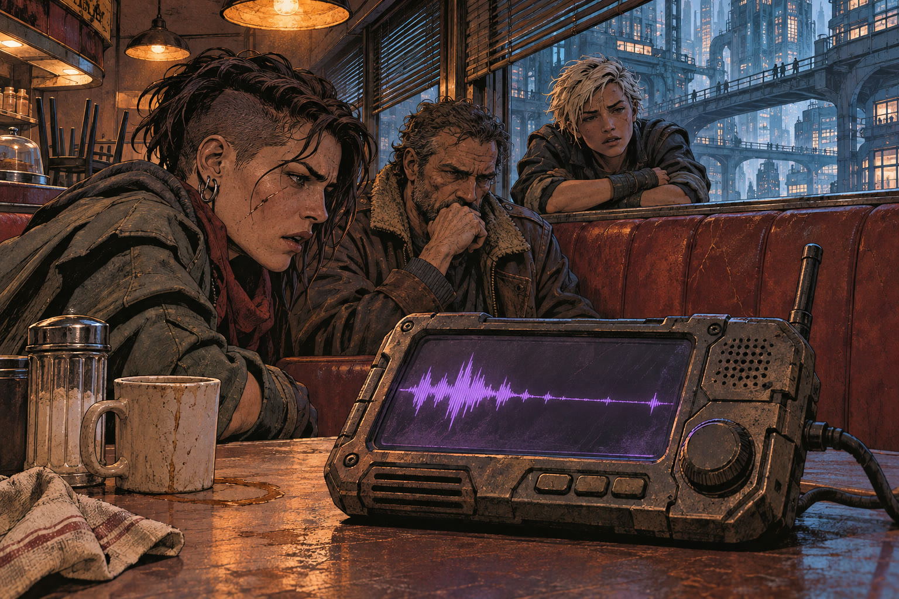
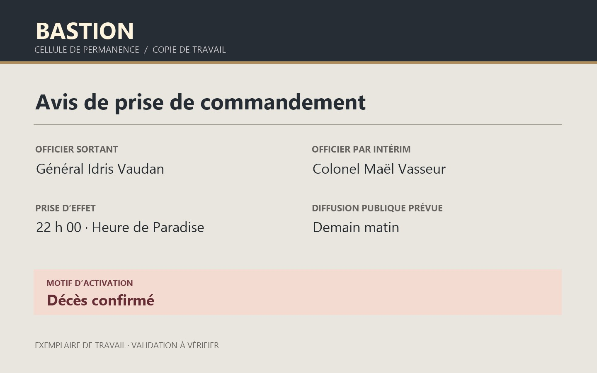
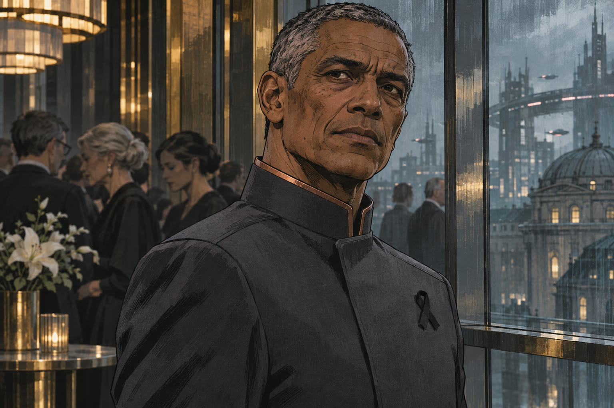
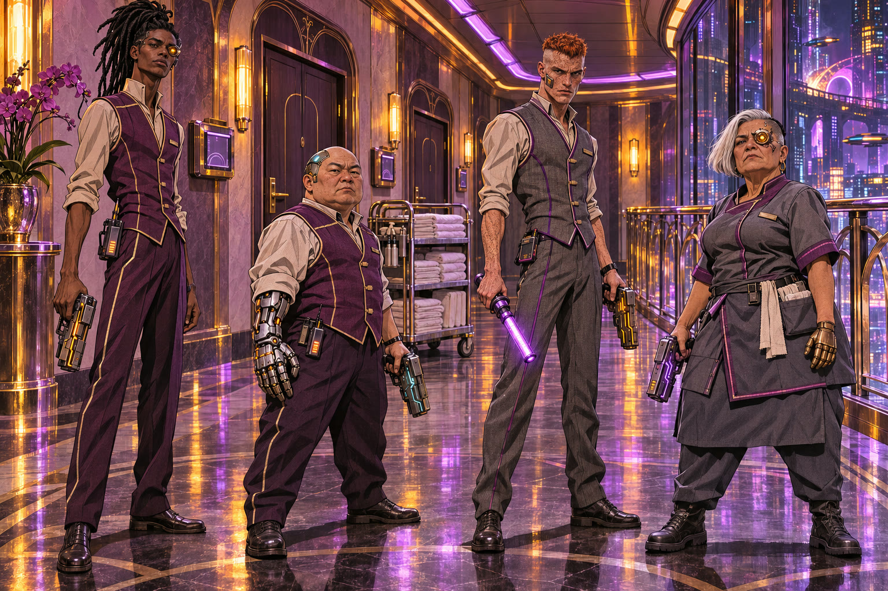
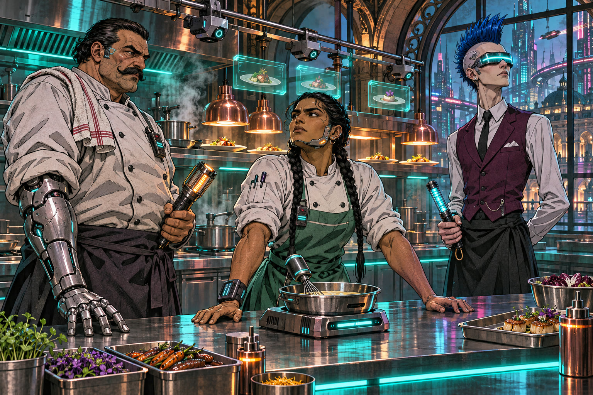
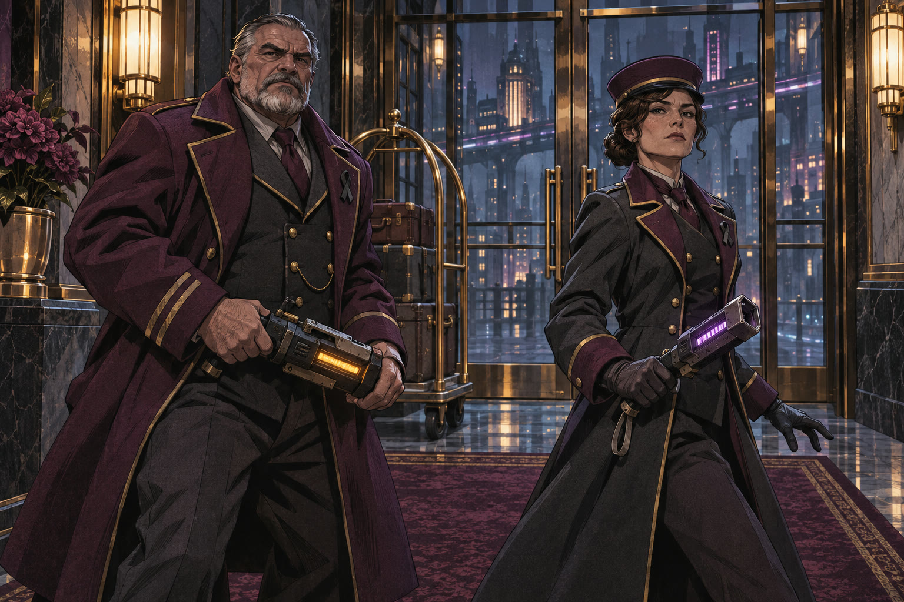
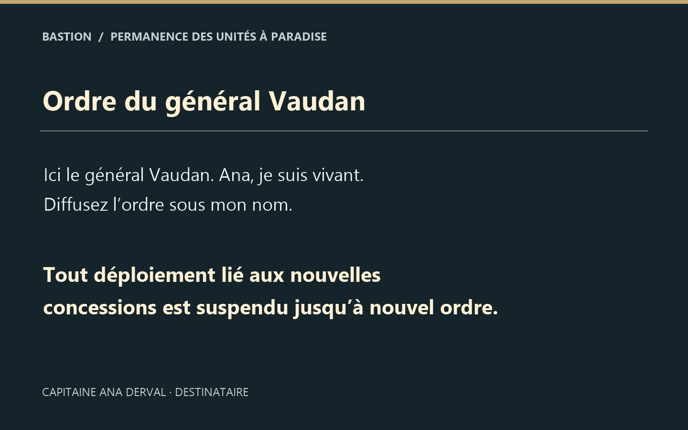

# Avant vingt-deux heures

*Suite de Tout le monde monte · Mark One, Brick et N1x, trois PJ de niveau 3 · 2 h à 2 h 45 · Enquête sous pression, négociation et combat d’extraction.*

## 01 · L’appel de Michel

**MJ uniquement.** Velvet a recueilli des secrets sur de hauts fonctionnaires et des membres du conseil d’administration du Cabinet. Elle s’en est servie pour obtenir des concessions et un droit de priorité à l’achat de bâtiments stratégiques. Ses succès commerciaux financent l’opération. Elle veut à présent que Bastion déploie des unités sur ces sites. Le général **Idris Vaudan**, habilité à valider l’engagement des unités concernées à Paradise, a refusé. Velvet a prévu sa mort et obtenu la coopération de son adjoint, le colonel **Maël Vasseur**, qui prendra le commandement par intérim si Vaudan est déclaré mort ou injoignable. Le Cabinet demeure le gouvernement de Paradise.

**Les trois contrats.** Un courtier du Hub engagé par Velvet a réparti le travail entre trois crews. La direction de l’hôtel leur a fourni les uniformes et les accès. **Contrepoids** doit s’emparer de Vaudan. **Trait Court** tient les cuisines en cas d’échec. **Quai Neuf** garde le vestibule des livraisons jusqu’à 22 h. Chaque crew connaît son secteur et son propre contrat. Contrepoids a pour consigne de remettre Vaudan à une équipe extérieure, qui se charge de le faire disparaître.

**La commanditaire est Killswitch.** Solène a survécu à la trahison des Camtards grâce à sa couverture de Seconde Chance. Elle a fait enlever Michel, qui a rapidement livré les détails des affaires de la crew. Elle se sert de ces aveux pour contraindre ses anciens camarades à contrer Velvet à sa place. Ses intermédiaires donnent l’impression d’une société disposant de moyens importants. Garder son identité côté MJ. Si les joueurs la devinent, jouer leur hypothèse. **Michel reste introuvable pendant cet arc. Loona manque cette séance et revient à la suivante.**

**Préparation.** Reprendre les PV, le matériel, les munitions et les assurances de la fin de Méridien. Appliquer les récupérations auxquelles les quelques jours de repos donnent droit. La solde de Nacre est déjà payée. Les repères 21 h 20, 21 h 40 et 22 h rythment la fiction. Les déplacements et décisions concrètes font avancer l’heure. La durée réelle des échanges à la table n’a aucun effet.

**À lire** après avoir demandé où les PJ passent cette soirée et ce qu’ils ont fait de leur repos.

> Michel appelle. Un souffle, une chaise qu’on repousse. « Les gars… ils viennent me chercher. Je suis au… » On entend Michel appeler quelqu’un par son prénom, trop loin du micro pour le comprendre. La communication coupe.

Laisser chacun agir. Le dernier secteur connu couvre plusieurs adresses et trop de passages pour identifier celle de Michel ce soir. Un contact de quartier peut confirmer l’heure de l’appel et fournir un point de départ pour de futures recherches. Une tentative de joindre Loona tombe sur sa messagerie. Les PJ peuvent lui laisser le contexte et les éléments qu’ils souhaitent partager.

## 02 · L’avis de prise de commandement

*21 h 20 · 15 à 20 min.*

Au terme d’une ellipse, la voix inconnue transmet deux courts extraits. Dans le premier, Michel situe un camion volé à un endroit que la table reconnaîtra. Adapter à un véhicule réellement volé en jeu. Dans le second, il précise un détail de la mort du gardien de la société de sécurité, à reprendre dans les souvenirs des joueurs. Il évoque aussi l’incendie de la boutique, des véhicules volés, les effractions et les dégâts. **Charlie rappelle.** Les forces de sécurité du Cabinet viennent de retrouver le véhicule sur un renseignement anonyme. Une demande au Syndicat ou à un contact civil permet aussi de vérifier ce fait.

> « À vingt-deux heures Bastion doit annoncer la mort du général Vaudan. Trouvez-le. Qu’il choisisse lui-même où il passe la nuit. Avant vingt-deux heures, il faut que ses officiers l’entendent. Faites ça et votre dossier reste chez moi quarante-huit heures. »

**Ce qu’elle transmet.** Le dernier rendez-vous de Vaudan est une cérémonie à l’hôtel des Arcades, une adresse de Velvet. L’avis interne annonce que Vasseur prendra le commandement à 22 h si Vaudan est déclaré décédé ou injoignable. Les mots « décès confirmé » figurent déjà sur l’exemplaire reçu. Le brouillon vient de la cellule de Vasseur. Une personne familière de Bastion reconnaît le format. Seule une confirmation interne peut authentifier l’avis.

Remettre l’adresse et l’avis sans jet. Si les PJ négocient, elle accepte une confirmation de survie par un officier choisi par Vaudan. Elle maintient son délai. Charlie peut vérifier la cérémonie et tenter de gagner du temps au Cabinet si une procédure est ouverte. L’équipe peut se séparer, solliciter un autre allié ou refuser. En cas de refus assumé, aller au bilan **Intérim installé** et jouer la transmission du dossier dans la fiction.

## 03 · L’hôtel des Arcades

*21 h 40 · 20 à 30 min.*

> À l’accueil, une employée retire un par un les cartons d’une table réservée aux familles. Le dernier indique « Salon Cèdre ». Au-dessus des portes vitrées, une passerelle relie l’hôtel à la tour voisine. Des invités y prennent encore des cafés. Personne n’a l’air pressé.

| Personne | Ce qu’elle veut | Ce qu’elle peut donner |
|---|---|---|
| **Eva Tellier**, responsable de salle | Rendre les affaires oubliées et faire sortir les familles au calme | Le dernier trajet du général vers le salon Cèdre. Elle transmet un message si on lui montre l’avis ou si on lui explique clairement le danger. |
| **Le lieutenant Oran Maret**, aide de camp | Préserver la cérémonie et la liberté de décision du général | Une audience courte s’il peut vérifier un détail. Il connaît la capitaine Ana Derval et sait que Vaudan lui répondra. |
| **La capitaine Ana Derval**, officier de permanence à distance | Recevoir des ordres authentifiés | Elle confirme qu’on lui a demandé de se préparer à recevoir les ordres de Vasseur dès 22 h. Elle attend un appel direct de Vaudan. |

**Trois entrées jouables.** À l’accueil, demander une audience ou faire transmettre l’avis. Dans le foyer public, demander à une famille qui vient de parler à Vaudan de faciliter la présentation. Par un contact de Bastion ou du Syndicat, faire appeler Maret pour obtenir une entrevue. Une approche convaincante fonctionne directement. Pour hâter une entrée incertaine, utiliser CHA (Influence) DD 12 ou ESPRIT (Intuition) DD 12 pour trouver la bonne personne. Sur un échec, le message passe après un délai et Eva ou Maret accompagne les PJ sous son propre nom. Le salon reste accessible.

**Indice facultatif.** Eva a reçu deux consignes successives pour la fin de la réception. La première prévoit une sortie des familles par le hall. La seconde réserve le couloir du salon Cèdre à des renforts affectés aux étages, aux cuisines et aux livraisons. Les noms des renforts manquent. Si on lui montre un badge de ce groupe, Eva peut vérifier qu’il est au nom d’un employé absent ce soir. Elle raccompagne les familles si les PJ lui donnent un avertissement concret. Dans ce cas, elles sont déjà à l’abri quand Contrepoids ouvre le feu.

## 04 · Qui vous paie ?

*21 h 50 · 20 à 25 min.*

> Vaudan replie sa veste sur le dossier d’une chaise. Son aide de camp avance d’un pas. Le général pose deux doigts sur le dossier, et Maret s’arrête. « Dites-moi d’abord qui vous paie. »

**Jouer Vaudan.** Il tient à éloigner les familles. Il veut choisir son itinéraire, son officier de confiance et ce qu’il révèle. Il reconnaît les Camtards. Leurs anciens liens avec Velvet lui donnent une raison de se méfier, et la rupture leur donne un mobile plausible pour monter un coup à l’hôtel. Il revient à une question difficile. « Vous avez un avis qui me donne pour mort. Qu’est-ce qui me prouve que la personne qui vous l’a donné veut me voir vivant ? » Il parlera du déploiement qu’il a refusé quand ils auront obtenu sa confiance ou qu’il devra expliquer l’ordre à suspendre.

Chaque raison concrète vaut un appui. Un PJ qui présente deux formulations du même argument gagne un seul appui.

- **Sincérité.** Raconter l’enlèvement, le chantage et ce que la voix a réellement demandé. Vaudan comprend pourquoi ils sont venus.
- **Confirmation.** Présenter une information déjà confirmée par Derval ou par un officier que Vaudan connaît. Si Vaudan veut appeler Derval lui-même, il doit encore entendre sa réponse pour gagner cet appui.
- **Protection concrète.** Obtenir l’évacuation des familles ou donner à Vaudan une solution dont il fixe lui-même les conditions. Laisser le PJ dire exactement ce qu’il propose.

| Appuis au moment du premier tir | Réponse de Vaudan |
|---|---|
| Deux ou trois | À son premier tour, il se met à couvert avec les Camtards et leur confie le choix de la sortie. Il contacte Derval dès qu’il trouve un moment sûr. |
| Un | Il se met à couvert avec Maret et demande aux PJ de leur ouvrir une issue. Il les suit si Maret confirme que le passage est libre. |
| Aucun | Il reste près de Maret et lui demande de vérifier l’avis auprès de Derval. Il refuse de suivre les PJ au premier échange. Une protection concrète ou une confirmation de Derval peut lui faire reconsidérer sa décision pendant le combat. |

**Couper l’entretien pendant qu’il hésite.** Laisser Vaudan poser sa question et les PJ formuler leur première réponse. CHA (Influence) DD 13 peut obtenir un appui si l’argument laisse le général décider et propose une vérification immédiate. Si Vaudan demande à Maret d’appeler Derval, laisser Maret lancer l’appel. **Contrepoids ouvre le feu avant la réponse de Derval ou dès que Vaudan exprime son prochain doute.** Avec deux appuis déjà obtenus, couper au moment où Vaudan est sur le point d’accepter. Reporter les appuis à la scène 05. Une protection concrète ou la confirmation attendue peut encore faire monter d’un cran sa confiance en cours de combat, dans la limite d’un appui par type.

> Vaudan regarde le terminal de Maret. « Passez-moi Derval. Je veux l’entendre de vive voix. » Une décharge frappe le montant de la porte. Le bois éclate entre vous et le général.

Si Vaudan a demandé une autre vérification, adapter sa réplique. Lancer l’initiative et ouvrir la scène 05 sans faire avancer les PJ ni Vaudan. Le premier tir touche le décor. Toute attaque contre un personnage se résout à l’initiative de Contrepoids. Si la crew a obtenu une entrevue plus tôt et a déjà fait sortir Vaudan, garder ce résultat et jouer la réaction de Contrepoids à l’hôtel selon les personnes encore présentes.

## 05 · Le service des étages

*Vers 21 h 54 · 15 à 20 min.*

**MJ uniquement.** **Contrepoids** est la crew chargée de la capture. **Lise Marot** commande ses trois équipiers sous l’uniforme d’une femme de ménage. Elle se tient dans l’encadrement côté couloir et ouvre le feu dès que Vaudan s’apprête à vérifier l’avis ou à repartir. Elle veut empêcher la transmission de l’ordre, remettre Vaudan vivant et revenir avec toute son équipe.

> Un valet pousse un chariot de linge en travers du couloir. Deux autres débouchent derrière lui, le gilet violet boutonné jusqu’au col. La femme en tunique grise garde son arme levée. « Monsieur Vaudan. Mettez le terminal au sol. »

[plan-etages]: images/etages-plan.png "Couloir des étages · 1 case = 1,5 m"

Vaudan part de B2 et Maret de C2, sauf placement déjà joué. Placer les **trois mercenaires déguisés en valets** en F3, G4 et H5. **Marot**, en tunique grise, commence en B3. Le chariot en F5–G5 donne un demi-couvert (+2 CA et aux sauvegardes de DEX appropriées). Deux groupes de civils se trouvent dans le hall, en A6 et C7, sauf si Eva les a déjà accompagnés dehors. Les PJ gardent les positions qu’ils occupaient pendant l’entretien.

**Choix de sortie.** La direction a fait fermer l’escalier public après le départ des derniers invités. Eva peut le rouvrir si les PJ ont gagné sa confiance. S’ils ont préparé ce détour ou trouvé une autre façon de rendre l’escalier praticable, ils peuvent y emmener Vaudan et passer directement au bilan. Par défaut, la sortie de service en K5–K6 reste ouverte et mène aux cuisines.

**Comportement.** Marot et le premier équipier en mesure de l’aider attaquent à leur initiative. Les autres barrent le passage ou couvrent leur repli. Le valet en F3 porte le bâton à impulsion. Les deux autres valets et Marot ont un pistolet à impulsion. Dès que deux membres sont hors combat, ont quitté leur position ou ont baissé leur arme, Marot donne la priorité à leur évacuation et laisse sortir les Camtards. Si un PJ propose à Contrepoids de repartir avec un équipier blessé, Marot écoute. Si le prix de la trêve reste incertain, CHA (Influence) DD 13 obtient un passage.

**Règles pour toute l’exfiltration.** Chaque crew adverse a une initiative commune (+1) et effectue au maximum deux attaques par round. Les contrats sont limités à un secteur. Dès que les Camtards ont franchi l’issue, la crew adverse se retire ou reste sur place pour ses blessés. Garder les PV d’une scène à l’autre. À deux PJ, un mercenaire de chaque groupe consacre son premier tour à couvrir le recul des siens et chaque crew effectue au maximum une attaque par round. À quatre PJ, ajouter 3 PV à chaque adversaire. Les actions qui retardent vraiment les Camtards peuvent rapprocher l’annonce de 22 h. Les repères horaires donnent l’allure par défaut et laissent leurs gains de temps aux joueurs.

Vaudan et Maret partagent l’initiative 10, après les PJ à égalité. Vaudan se déplace ou appelle Derval. Maret guide des civils, ouvre une issue ou aide à porter un blessé. Un PJ adjacent à Vaudan a une réaction pour s’interposer quand une attaque vise le général. Résoudre l’attaque sur le PJ à la place. Un PJ adjacent peut déplacer un blessé stable avec une action et la moitié de sa vitesse. Un groupe de civils a CA 10 et s’arrête s’il doit aider un blessé. Une action permet de l’accompagner vers une sortie dégagée.

**Appeler Derval.** Une action et un échange intelligible permettent à Vaudan de s’authentifier et de transmettre son ordre. Il peut le faire au salon, depuis un espace à l’abri ou dès la sortie. Si Maret a lancé l’appel, Derval décroche avant le premier tour du duo à l’initiative 10. Elle peut confirmer l’intérim annoncé à Vaudan et rester en ligne pour recevoir l’ordre. Un PJ ou Maret peut prêter son terminal. Si Vaudan est inconscient, Derval accepte un signalement de Maret et gèle l’intérim jusqu’à ce qu’un officier voie le général.

### Mercenaire de Contrepoids

*Trois valets de chambre de couverture · Initiative commune +1*

- **CA** 12
- **PV** 8 chacun
- **Vitesse** 9 m
- **FOR** +1 · **DEX** +1 · **CON** +1 · **ESPRIT** +0 · **CHA** +0

**Bâton à impulsion.** Mêlée +3, allonge 1,5 m, 1d6 + 1 contondants. **Pistolet à impulsion.** Distance +3, portée 12 m, 1d6 électriques. Chaque valet emploie l’arme qu’il porte.

### Lise Marot

*Cheffe de Contrepoids en tenue de femme de ménage · Initiative commune +1*

- **CA** 13
- **PV** 12
- **Vitesse** 9 m
- **FOR** +0 · **DEX** +2 · **CON** +1 · **ESPRIT** +1 · **CHA** +1

**Pistolet à impulsion.** Distance +4, portée 12 m, 1d6 + 1 électriques. Marot peut consacrer son action à négocier la sortie des siens. Elle se rend si toute son équipe a été mise hors combat et qu’on lui permet de vérifier leur état.

### Général Idris Vaudan

*PNJ à protéger · Initiative 10*

- **CA** 13
- **PV** 19
- **Vitesse** 7,5 m
- **FOR** +1 · **DEX** +1 · **CON** +2 · **ESPRIT** +2 · **CHA** +2

À 0 PV, Vaudan et Maret sont stables et inconscients. Maret a CA 13, 15 PV, vitesse 9 m et DEX +1. Si Vaudan et les Camtards ont déjà quitté l’hôtel, Contrepoids cherche seulement à retrouver sa trace. Les PJ peuvent garder leur avance et partir.

## 06 · Derrière le passe

*Vers 21 h 57 · 15 à 25 min.*

**MJ uniquement.** **Trait Court** a été payé pour intercepter une cible au passage. Le courtier lui a présenté le contrat comme un transfert autorisé par Bastion. Le serveur de couverture a déjà demandé par écrit quel officier avait donné l’ordre. Il attend toujours le nom.

> Le passe est encore éclairé. Sous les lampes, trois assiettes refroidissent. Deux cuisiniers se tournent vers vous, les manches relevées. Le serveur à côté d’eux pose son plateau et fait jaillir une lumière violette d’un bâton court.

[plan-cuisines]: images/cuisines-plan.png "Cuisines et passe · 1 case = 1,5 m"

Les PJ entrent depuis le couloir en A4 avec Vaudan et Maret s’ils les accompagnent. **Deux mercenaires en tenue de cuisine** en G3 et I4 portent des pistolets à impulsion. **Le faux serveur** en H4 porte le bâton. Les plans de travail en E3–F3 et G5–H5 donnent un demi-couvert. La porte entre I4 et J4 mène au sas des livraisons. Un membre de Trait Court en I4 peut la bloquer en dépensant son action à la tenir. Un PJ qui l’écarte, obtient son départ ou passe derrière lui dégage l’issue.

**Ce qui change ici.** Les deux faux cuisiniers attaquent si les Camtards avancent. Le troisième garde le sas. Si Vaudan conteste l’ordre lui-même ou si Derval confirme que Bastion n’a mandaté personne, le faux serveur baisse son arme et demande une vérification au courtier. Une autre preuve crédible peut obtenir le même résultat avec CHA (Influence) DD 13. Dès qu’un équipier renonce ou tombe, le serveur ouvre l’issue contre la promesse que son groupe pourra se retirer. Jouer la réaction de ses partenaires selon ce qu’ont fait les Camtards.

### Mercenaire de Trait Court

*Deux cuisiniers et un serveur de couverture · Initiative commune +1*

- **CA** 12
- **PV** 10 par cuisinier, 8 pour le serveur
- **Vitesse** 9 m
- **FOR** +1 · **DEX** +1 · **CON** +1 · **ESPRIT** +0 · **CHA** +0

**Pistolet à impulsion des cuisiniers.** Distance +3, portée 12 m, 1d6 + 1 électriques. **Bâton du serveur.** Mêlée +3, allonge 1,5 m, 1d6 + 1 contondants. Le groupe garde la limite d’attaques de l’exfiltration.

## 07 · Les portiers

*Vers 21 h 59 · 10 à 15 min.*

**MJ uniquement.** **Quai Neuf** travaille en duo. Son contrat paie la tenue du vestibule jusqu’à 22 h, puis une prime si Vaudan reste dans l’hôtel. Il ne reçoit plus de réponse du courtier après les premiers tirs. Amine et Mireille veulent préserver leur réputation, toucher leur acompte et sortir ensemble.

> De l’autre côté des portes vitrées, les lumières de Paradise défilent sous la rampe des livraisons. Dans le vestibule, deux portiers en manteaux taillés attendent devant un chariot à bagages. L’un d’eux a encore son ruban de deuil. Il vous demande de laisser Vaudan avec eux.

[plan-sortie]: images/sortie-plan.png "Vestibule des livraisons · 1 case = 1,5 m"

Les PJ arrivent de l’ouest en A4. Les deux membres de Quai Neuf, **Amine Sorel** et **Mireille Vial**, commencent en H3 et I5 sous leurs uniformes de portiers. Le chariot D4–E4 donne un demi-couvert. La porte entre I4 et J4 débouche sur une rampe publique qui permet de sortir en L4. Mireille peut ouvrir la porte. En I3, un PJ peut dépenser une action au panneau pour l’ouvrir et la maintenir ouverte jusqu’à son prochain tour. Si un PJ a déjà trouvé une autre issue praticable, laisser la crew la prendre et sauter cette rencontre.

**Choisir ce qui compte avant 22 h.** Derval rappelle Vaudan ou Maret si l’un d’eux l’a jointe. Passer le terminal est une interaction. Le général peut garder le chariot entre lui et les portiers et dépenser son action à donner l’ordre pendant que les PJ maintiennent le passage. L’intérim est annoncé si l’heure prévue est atteinte avant toute confirmation. Une confirmation tardive permet de le contester.

**Le dernier groupe.** Après leur demande, les mercenaires attaquent si les Camtards avancent vers la rampe. Amine propose de laisser passer Vaudan s’il apprend que Derval l’a reconnu vivant. Il estime que la prime ne vaut plus le risque. Mireille tient la porte tant qu’elle a son partenaire à ses côtés. Si elle se retrouve seule ou que les PJ ont déjà dégagé la rampe, elle propose de repartir avec Amine. Les échanges laissent du temps au général pour répondre à Derval.

### Mercenaire de Quai Neuf

*Deux portiers de couverture · Initiative commune +1*

- **CA** 13
- **PV** 12 chacun
- **Vitesse** 9 m
- **FOR** +1 · **DEX** +2 · **CON** +1 · **ESPRIT** +0 · **CHA** +1

**Pistolet à impulsion.** Distance +4, portée 12 m, 1d6 + 1 électriques. Un mercenaire peut consacrer son action à appeler le courtier ou à négocier le repli de son partenaire, ce qui donne aux PJ une fenêtre pour agir.

## 08 · Un ordre qui porte

*15 à 20 min · Terminer sur une conséquence que la crew peut constater.*

> « Ici le général Vaudan. Ana, je suis vivant. Diffusez l’ordre sous mon nom. Tout déploiement lié aux nouvelles concessions est suspendu jusqu’à nouvel ordre. »

| État final | Effet immédiat | Accroche |
|---|---|---|
| Vaudan vivant et ordre reconnu | Derval suspend le déploiement des unités concernées. Killswitch retient la transmission du dossier pendant les 48 heures promises. | Vaudan accepte un rendez-vous ultérieur et nomme l’interlocuteur de Velvet qui lui a présenté le contrat. Le nom reste à attribuer selon la campagne. |
| Vaudan sauvé, ordre en retard | L’intérim est annoncé. Derval demande une confirmation en personne et partage les premières instructions de Vasseur. Killswitch accorde le délai si un officier a confirmé la survie. Sans confirmation, elle exige celle-ci avant la fin de la nuit. | Convoquer un officier neutre ou obtenir le retrait d’une unité devient la prochaine urgence. |
| Intérim installé | Vasseur prend le commandement des unités concernées. Velvet parle d’une vengeance de ses anciens mercenaires si les Camtards ont été reconnus sur place. La commanditaire transmet les éléments promis au Cabinet si la crew refuse le contrat ou a délibérément abandonné Vaudan. Si elle a tenté le secours et échoué, elle donne jusqu’au matin pour que Derval obtienne un fait vérifiable. | Charlie transmet le premier effet vérifiable de la procédure. Une enquête s’ouvre. Les décisions des forces du Cabinet suivent leurs propres délais. |

Sur un succès, laisser Vaudan leur demander ce qu’ils veulent que Bastion dise de leur intervention. Si des civils ont été aidés, Eva donne leur version à Derval. Un mercenaire prêt à parler peut donner le nom de sa crew et son ordre de mission. **Deux récits indépendants désignent le même courtier du Hub.** Un seul récit suffit pour que Charlie confirme que la crew citée travaille au Hub. Marot peut aussi confirmer que Contrepoids devait remettre Vaudan à une équipe extérieure. Les uniformes viennent de l’hôtel. La relation entre le courtier, cette équipe et la direction de Velvet reste un sujet d’enquête.

**À la séance suivante.** Loona revient avec une liste de bâtiments sur lesquels l’intérim devait déployer Bastion. Accorder à sa joueuse le choix de la manière dont elle a obtenu le premier indice. Si Vaudan est disponible, il reconnaît les sites de l’ordre qu’il a refusé. Sinon, Derval confirme que leur liste correspond à ses instructions de la nuit. Les concessions concernent des sites précis. Les droits de préemption donnent à Velvet la priorité lors de leur mise en vente. La liste et l’ordre suffisent à ouvrir l’enquête sur les décisions du Cabinet. Michel demeure introuvable et Killswitch garde sa couverture.

**Suivi à noter.** Heure et témoin de la confirmation, état de Vaudan, de Maret et des civils, crews identifiées, mercenaires prêts à témoigner, personnes ayant reconnu les Camtards, indice emporté, échéance du chantage.
